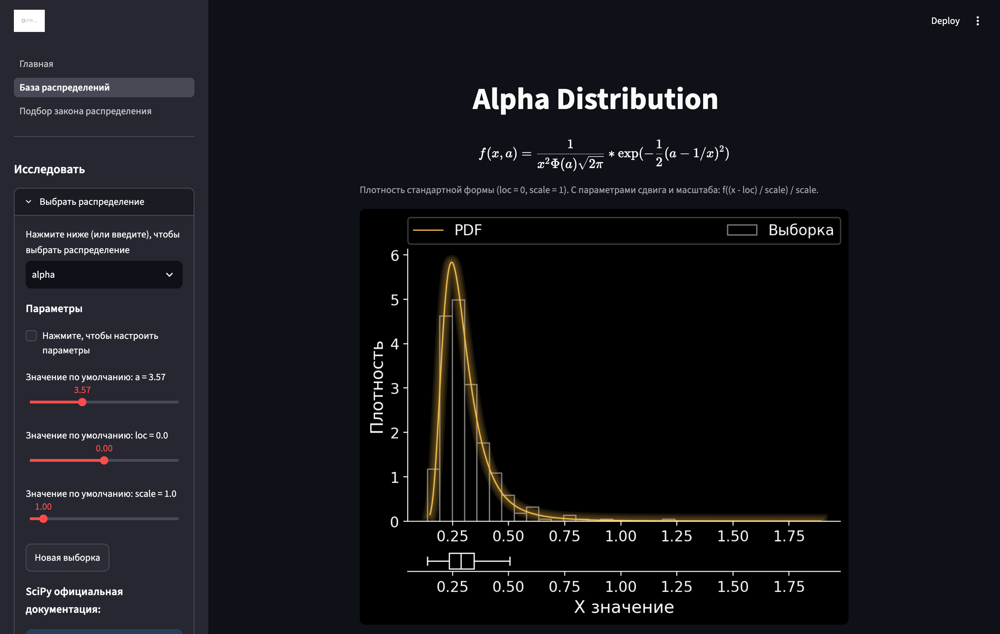

<div align="center">

# Distribution Fitting

**Справочник распределений вероятностей и подбор распределения по данным. Для риск-менеджеров.**

Двигайте параметры и смотрите, как меняются плотность, функция распределения и выборка. Или загрузите свои данные и узнайте, какое распределение описывает их лучше всего.

<a href="https://distribution-fitting.streamlit.app">
  
</a>


<a href="https://distribution-fitting.streamlit.app">
  
</a>

</div>

## Возможности

### Распределения: непрерывные и дискретные

| | |
| --- | --- |
| **97 непрерывных и 19 дискретных** | Все распределения из документации SciPy, которые есть в установленной версии |
| **Параметры** | Ползунки для параметров формы, `loc` и `scale` в границах области определения каждого параметра. Недопустимое сочетание даёт предупреждение, а не ошибку |
| **Графики** | PDF, CDF и функция выживания, гистограмма и блочная диаграмма случайной выборки, тёмная и светлая тема |
| **Квартили и σ** | Квартили распределения и области «среднее ± 1/2/3σ» с подписью реальной вероятности попадания: 68/95/99.7% верны только для нормального распределения |
| **Формула** | Плотность в LaTeX из документации SciPy и ссылка на страницу распределения |
| **Статистика** | Таблица: теоретические значения распределения рядом с оценками по выборке |
| **Калькулятор** | Вероятность интервала, квантили, VaR и Expected Shortfall для левого или правого хвоста |
| **Ссылка** | Адрес страницы хранит распределение и параметры: открывает тот же график |
| **Экспорт** | Готовый скрипт Python, который строит тот же график и ту же выборку |

### Подбор закона распределения

| | |
| --- | --- |
| **Данные** | CSV или TXT с любым разделителем столбцов, десятичная точка или запятая, разделители тысяч; встроенный пример — модельные дневные доходности |
| **Подгонка** | Метод максимального правдоподобия для выбранных распределений или для всех сразу |
| **Сравнение** | Таблица с AIC, BIC, статистиками Колмогорова — Смирнова и Андерсона — Дарлинга, отсортированная по AIC |
| **Проверка согласия** | p-значения методом Монте-Карло: параметры переоцениваются на каждой модельной выборке, поэтому значения не завышены |
| **Интервалы** | Бутстреп-интервалы для параметров и для VaR |
| **Риск** | VaR и Expected Shortfall подобранного распределения |
| **Проверки** | Подгонки с ненормированной плотностью или неограниченным правдоподобием отбрасываются с объяснением причины; вырожденные помечаются |
| **Графики** | Гистограмма данных с лучшими плотностями и Q-Q график |
| **Экспорт** | Таблица результатов, данные и скрипт Python, повторяющий подгонку |

Приложение сравнивает модели, но не выбирает за вас: лучшее из подобранных распределений не обязательно верное.

## Запуск

### В браузере

Откройте <https://distribution-fitting.streamlit.app> или нажмите на красную кнопку вверху страницы. Ставить ничего не нужно.

### Локально

```sh
git clone https://github.com/reraaaaa/Distribution-fitting
cd Distribution-fitting
pip install -r requirements.txt
streamlit run streamlit_app.py
```

Нужен Python 3.12 или новее. Приложение откроется на <http://localhost:8501>. При старте нужен интернет: список распределений читается из документации SciPy.

### Свой экземпляр на Streamlit Community Cloud

1. Сделайте форк репозитория.
2. На [share.streamlit.io](https://share.streamlit.io) создайте приложение: ветка `master`, файл `streamlit_app.py`.

## Разработка

```sh
pip install -r requirements-dev.txt
pytest          # около 15 минут; сеть не нужна, страницы документации SciPy сохранены в tests/fixtures
ruff check .
```

| Путь | Что внутри |
| --- | --- |
| `streamlit_app.py` | Точка входа и навигация по страницам |
| `app_pages/` | Страницы: главная, непрерывные и дискретные распределения, подбор закона распределения |
| `ParsDistributions/` | Список распределений из документации SciPy, формулы и параметры по умолчанию из самого SciPy |
| `UtilitySt/` | Выборка и проверка параметров, меры риска, подгонка распределений, рисунки matplotlib, генераторы скриптов |
| `tests/` | Тесты, включая прогон приложения по каждому распределению |

## Лицензия

MIT, см. [LICENSE](LICENSE).
